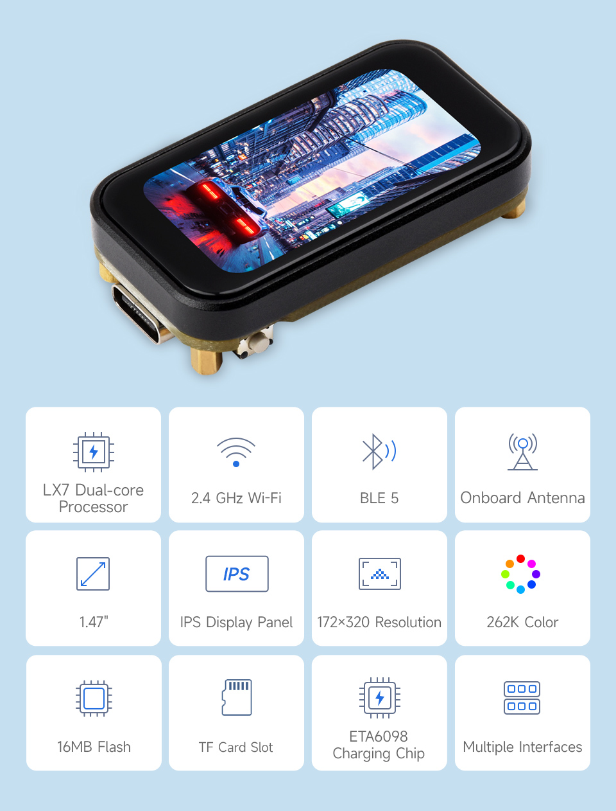

  <h1>ESP32-S3-Touch-LCD-1.47</h1>
  
<strong>ESP32-S3 1.47-inch 172 × 320 capacitive touch display board</strong>

  
<strong>English</strong> | <a href="README_ZH.md">简体中文</a>

  
  

  
<a href="https://www.waveshare.com/ESP32-S3-Touch-LCD-1.47.htm">🛒 Product</a> · <a href="firmware/">📦 Firmware</a> · <a href="examples/esp-idf/">🧩 ESP-IDF</a> · <a href="examples/arduino/examples/">🔧 Arduino</a> · <a href="https://www.waveshare.com/wiki/ESP32-S3-Touch-LCD-1.47">📖 Documentation</a>

  

---

## ✨ Overview

A compact ESP32-S3 board with JD9853 SPI display, AXS5106L I2C touch controller, 16 MB Flash, 8 MB PSRAM and TF card slot. This repository provides ESP-IDF and Arduino examples, factory source and tested firmware images.

| Feature | Device / interface |
| --- | --- |
| MCU | ESP32-S3 |
| Memory | 16 MB Flash, 8 MB PSRAM |
| Display | 1.47-inch 172 × 320, JD9853 SPI |
| Touch | AXS5106L I2C capacitive touch |

## 📦 Quick Start

Download a tested image from the [firmware directory](firmware/) and flash it at `0x0`. Install the required framework version listed below when building examples from source.

Factory recovery firmware is [ESP32-S3-Touch-LCD-1.47_FactoryOnly_20250508.bin](firmware/ESP32-S3-Touch-LCD-1.47_FactoryOnly_20250508.bin).

## 🧪 Examples

See the ESP-IDF and Arduino example directories for build instructions. The factory source is in [examples/factory](examples/factory/).

[Factory Demo](examples/esp-idf/01_factory/) exercises the touchscreen, backlight, and Wi-Fi scanning.

## 🛠️ Development Environment

| Framework | Version | Examples |
| --- | --- | ---: |
| ESP-IDF | v5.4.4 | 5 projects plus factory |
| Arduino-ESP32 | 3.1.1 | 6 sketches |

## 📚 Resources

- [Product page](https://www.waveshare.com/ESP32-S3-Touch-LCD-1.47.htm)
- [Wiki](https://www.waveshare.com/wiki/ESP32-S3-Touch-LCD-1.47)

## 🤝 Support

- [Open an issue](https://github.com/waveshareteam/ESP32-S3-Touch-LCD-1.47/issues/new/choose)
- [Waveshare support](https://service.waveshare.com/)

## 📄 License

Apache License 2.0. See [LICENSE](LICENSE).

