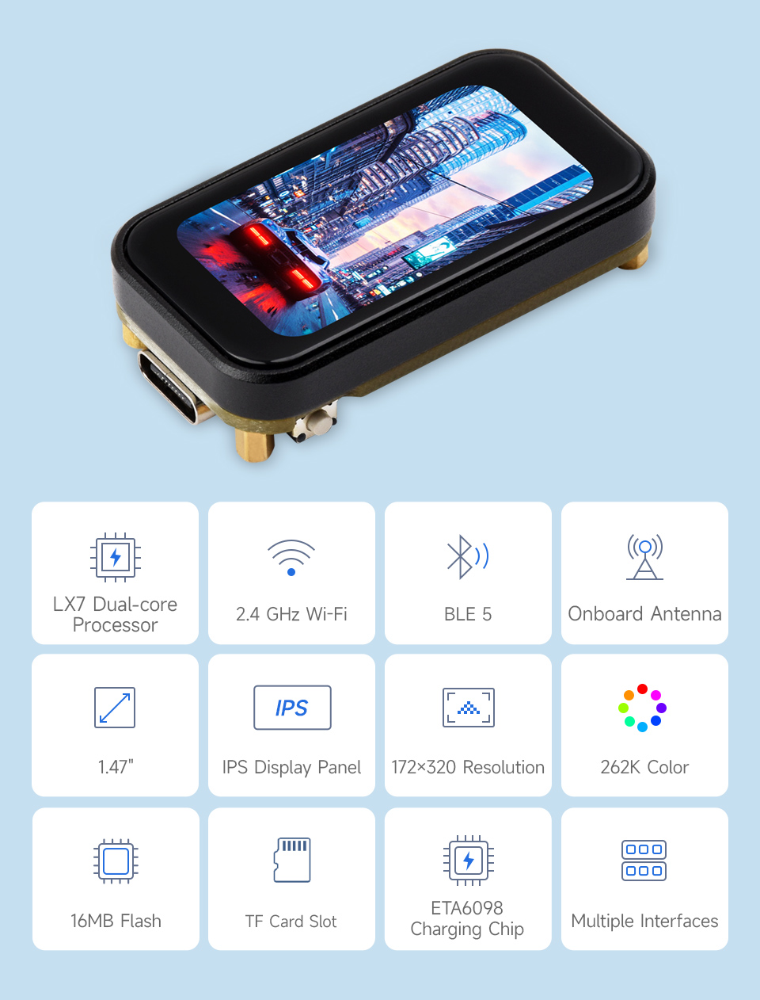

  <h1>ESP32-S3-Touch-LCD-1.47</h1>
  
<strong>ESP32-S3 1.47 英寸 172 × 320 电容触摸显示开发板</strong>

  
<a href="README.md">English</a> | <strong>简体中文</strong>

  
  

  
<a href="https://www.waveshare.com/ESP32-S3-Touch-LCD-1.47.htm">🛒 产品</a> · <a href="firmware/">📦 固件</a> · <a href="examples/esp-idf/">🧩 ESP-IDF</a> · <a href="examples/arduino/examples/">🔧 Arduino</a> · <a href="https://docs.waveshare.net/ESP32-S3-Touch-LCD-1.47/">📖 文档</a>

  

---

## ✨ 概述

本开发板采用 ESP32-S3，配备 JD9853 SPI 显示、AXS5106L I2C 触摸、16 MB Flash、8 MB PSRAM 和 TF 卡槽。本仓库包含 ESP-IDF、Arduino 示例、出厂源码和实测固件。

## 📦 快速开始

从[固件目录](firmware/)下载镜像并从 `0x0` 烧录。出厂恢复固件为 [ESP32-S3-Touch-LCD-1.47_FactoryOnly_20250508.bin](firmware/ESP32-S3-Touch-LCD-1.47_FactoryOnly_20250508.bin)。

## 🧪 示例

示例位于 [ESP-IDF](examples/esp-idf/) 和 [Arduino](examples/arduino/examples/)，出厂源码位于 [examples/factory](examples/factory/)。

[出厂功能演示](examples/esp-idf/01_factory/README_ZH.md)展示触摸测试、背光调节和 Wi-Fi 扫描。

## 🛠️ 开发环境

ESP-IDF v5.4.4，Arduino-ESP32 3.1.1。

## 📚 资料

- [产品页](https://www.waveshare.com/ESP32-S3-Touch-LCD-1.47.htm)
- [中文 Wiki](https://docs.waveshare.net/ESP32-S3-Touch-LCD-1.47/)

## 🤝 支持

- [提交问题](https://gitee.com/waveshare/ESP32-S3-Touch-LCD-1.47/issues)
- [微雪技术支持](https://service.waveshare.com/)

## 📄 许可证

Apache License 2.0，详见 [LICENSE](LICENSE)。

